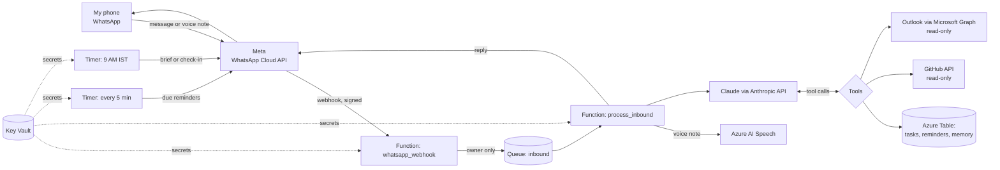

# Architecture

## The flow

## Each piece, in plain words

**Meta WhatsApp Cloud API.** Meta's official way for software to send and receive WhatsApp messages.
The bot gets its own number (Meta's free test number to start, a new SIM later). Meta calls our
webhook whenever a message arrives, and signs each call with the app secret so we can prove it came
from Meta.

**Function App (Azure Functions, Flex Consumption plan).** Small pieces of Python that Azure runs only
when needed, billed per use. There are four:

1. `whatsapp_webhook`: checks Meta's signature, throws away anything not from my number, puts the
   message on a queue and answers Meta straight away. Meta resends messages it thinks were not
   received, so answering fast matters.
2. `process_inbound`: takes a message off the queue. Voice notes go to Azure Speech first. Then
   Claude reads the message with the last 20 messages for context and decides which tools to use.
   The reply goes back through Meta.
3. `reminder_tick`: every 5 minutes, sends reminders that are due.
4. `morning_brief`: at 03:30 UTC (9:00 IST), sends the brief.

**The queue (Azure Storage queue).** A holding area between "message arrived" and "message handled".
If the worker fails, the message is retried once; a message ID check means it is never answered twice.

**Azure Table (in the same storage account).** The assistant's own memory: tasks, reminders,
conversation history (last 20 turns only) and small bits of state such as when I last messaged.
Each row keeps its fields as JSON, so adding fields needs no database change.

**Claude (Anthropic API).** The brain. It gets a system prompt (who it works for, the time now, the
rules), the conversation, and a list of tools. It answers by calling tools and then writing a reply.
The loop in `cos/agent.py` runs at most 8 tool steps per message. Model: Claude Sonnet 5.5 by default
(setting `ANTHROPIC_MODEL`).

**Tools.** Functions Claude may call:

| Tool | Reads or writes | Where |
|---|---|---|
| add_task, update_task, list_tasks | Writes its own list | Azure Table |
| set_reminder, list_reminders, cancel_reminder | Writes its own list | Azure Table |
| github_project_status, github_recent_failures | Reads only | GitHub |
| outlook_calendar, outlook_search_mail | Reads only | Outlook.com |

**Azure AI Speech.** Turns voice notes into text. Listens for English (India) and Hindi.

**Key Vault.** Holds every secret (WhatsApp token, app secret, Anthropic key, GitHub token, Outlook
refresh token, Speech key). The Function App has its own identity (a managed identity) with permission
to read secrets only. App settings point at Key Vault rather than holding the values.

## The WhatsApp 24-hour rule

WhatsApp lets a business message someone freely for 24 hours after that person's last message. After
that, only pre-approved **templates** can be sent. So:

- If I messaged in the last ~24 hours, reminders and the brief go as normal messages.
- Otherwise a reminder goes as the `cos_reminder` template, and the morning brief goes as the
  `cos_checkin` template with a "Show brief" button. Tapping it reopens the window and the full brief
  follows.

## Why these choices

- **Official WhatsApp API, not a WhatsApp Web library.** Unofficial libraries break WhatsApp's terms
  and can get the number banned. Meta's API terms (from 15 Jan 2026) bar general-purpose AI chatbots,
  so this bot is scoped as a personal task and follow-up assistant. The messaging layer is one file
  (`cos/whatsapp.py`): moving to Telegram would mean replacing that file only.
- **Azure Functions, not a VM.** Nothing to patch, and the cost is close to zero at one user's volume.
- **Table Storage, not Cosmos DB.** One user, a few hundred rows: the simplest store that works.
- **Read-only integrations.** The assistant reads untrusted text (other people's emails). Keeping it
  unable to send or change anything outside its own list removes the worst outcomes of prompt
  injection.
- **Morning brief built without AI.** It is the same shape every day, so plain code is cheaper and
  never wrong about what is in the list.

## Cost (rough, one user)

Azure Functions, storage, Key Vault: cents a month. Speech: free tier (5 audio hours a month). Claude:
a few US cents per busy day on Sonnet. WhatsApp: replies within the 24-hour window are free; template
messages (reminders outside the window, the morning check-in) are charged per message by Meta.
